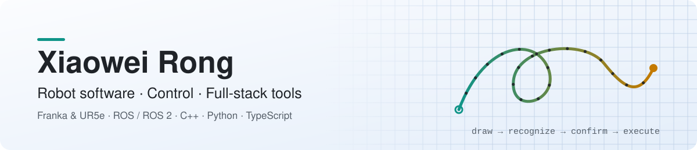

<picture>
  <source media="(prefers-color-scheme: dark)" srcset="assets/banner-en-dark.svg">
  
</picture>

<b>English</b> · <a href="https://github.com/feizaodemon/feizaodemon/blob/main/README.zh-CN.md">简体中文</a>

I build robot software end to end: recognition and supervision logic, Cartesian and torque controllers on Franka arms, and the experiments and tests that show whether they work. When a spreadsheet stops being enough, I build the tool myself.

## Featured project

### [Magnetic Trajectory Robot Interface](https://github.com/feizaodemon/magnetic-trajectory-robot-interface)

Draw a symbol on a magnetic board or with the mouse. The system recognizes it, the operator confirms it, and only then does the robot run the matching task.

  
  
  
  

- **Gesture to task.** A DTW template bank ranks pen or mouse strokes, with confidence and margin gates that reject unclear input. Five alternative recognizers are benchmarked against it under noise, rotation and truncation.
- **Confirmation-gated control.** Recognition, confirmation, dispatch and execution are separate ROS nodes. Only the dispatcher can command the robot, and only after an explicit confirm.
- **One teleop core, two robots.** A C++ Cartesian core with damped-least-squares IK drives both a Gazebo Panda and a Franka FR3 adapter.

ROS1 Noetic · Python · C++ · Gazebo · Docker → [Design decisions](https://github.com/feizaodemon/magnetic-trajectory-robot-interface/blob/main/docs/DESIGN_DECISIONS.md)

## More work

These repositories are private (team, coursework or personal data), so they are described here instead of linked.

<table>
<tr>
<td width="33%" valign="top">

**GP torque compensation** 
Team research project · ROS 2 · Python

Learning the residual joint torque of a Franka Panda with Gaussian processes and feeding a small, clipped share back into an impedance controller.

My part: code development, including the experiment switches that made frozen-GP tests possible; real-robot testing in the lab; a staged test programme with a plan and report for each stage; and the offline analysis that compared the online GPs with a historical residual database.

</td>
<td width="33%" valign="top">

**Job-search workbench** 
Personal tool · TypeScript · Fastify · React · SQLite

A self-hosted tracker I use every day instead of a spreadsheet. Jobs and applications are kept separate, and every status change is written as an event in the same transaction.

34 API routes, 420+ test cases in CI, and a Chrome extension that only saves jobs and asks for just 3 permissions.

</td>
<td width="33%" valign="top">

**Robot manipulation coursework** 
Group projects · ROS 2 · C++

Four Franka and UR5e projects. In each one I worked on the code and on the real-robot tests.

- task-priority IK under a remote-center-of-motion constraint, run on a real FR3
- hand-taught trajectories replayed by a custom joint-impedance torque controller
- a vision-triggered button press
- an SVG drawing study explaining 77 s simulated vs. about 180 s real cycle time

</td>
</tr>
</table>

## Toolbox

  
  
  
  
  
  
  
  
  
  
  

