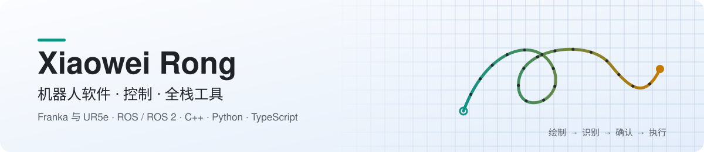

<picture>
  <source media="(prefers-color-scheme: dark)" srcset="assets/banner-zh-dark.svg">
  
</picture>

<a href="https://github.com/feizaodemon">English</a> · <b>简体中文</b>

我做端到端的机器人软件：识别与监督逻辑、Franka 机械臂上的笛卡尔控制和力矩控制，以及验证它们是否真正有效的实验和测试。表格不够用的时候，我会自己写工具。

## 代表项目

### [磁性轨迹机器人交互系统（Magnetic Trajectory Robot Interface）](https://github.com/feizaodemon/magnetic-trajectory-robot-interface)

在磁性画板上或用鼠标画一个符号，系统识别后由操作员确认，确认之后机器人才执行对应任务。

  
  
  
  

- **从手势到任务**：DTW 模板库对笔迹或鼠标轨迹排序，置信度和差距门限会拒绝不清楚的输入；另外在噪声、旋转、截断扰动下与 5 种替代识别器做了对比评测。
- **确认后才执行**：识别、确认、调度、执行是四个独立的 ROS 节点。只有调度节点能给机器人下指令，而且必须在操作员明确确认之后。
- **一套遥操作核心驱动两台机器人**：基于阻尼最小二乘逆运动学的 C++ 笛卡尔核心，同时驱动 Gazebo 中的 Panda 和 Franka FR3 适配器。

ROS1 Noetic · Python · C++ · Gazebo · Docker → [设计决策（英文）](https://github.com/feizaodemon/magnetic-trajectory-robot-interface/blob/main/docs/DESIGN_DECISIONS.md)

## 其他项目

以下仓库是私有的（团队项目、课程作业或含个人数据），所以这里只做文字介绍，不放链接。

<table>
<tr>
<td width="33%" valign="top">

**高斯过程力矩补偿** 
团队科研项目 · ROS 2 · Python

用高斯过程学习 Franka Panda 的关节力矩残差，并把经过缩放和限幅的一小部分预测反馈给阻抗控制器。

我负责的部分：让 frozen GP 实验成为可能的实验开关、分阶段的真机实验计划（每个阶段都有计划和报告），以及对比在线 GP 与历史残差数据库的离线分析。

</td>
<td width="33%" valign="top">

**求职工作台** 
个人工具 · TypeScript · Fastify · React · SQLite

自己部署、每天在用的求职管理工具，替代了 Excel 表格。岗位和投递分开管理，每次状态变化都在同一个事务里记录为事件。

34 个 API 路由、CI 中 420+ 个测试用例，配一个只保存岗位、只申请 3 个权限的 Chrome 扩展。

</td>
<td width="33%" valign="top">

**机器人操作课程项目** 
小组项目 · ROS 2 · C++

四个 Franka 与 UR5e 项目：

- 远心点（RCM）约束下的任务优先级逆运动学，已在 FR3 实机上运行
- 手动示教轨迹，由自定义关节阻抗力矩控制器回放
- 视觉触发的按钮按压
- SVG 绘图实验，分析仿真 77 s 与实机约 180 s 节拍差异的原因

</td>
</tr>
</table>

## 技术栈

  
  
  
  
  
  
  
  
  
  
  

